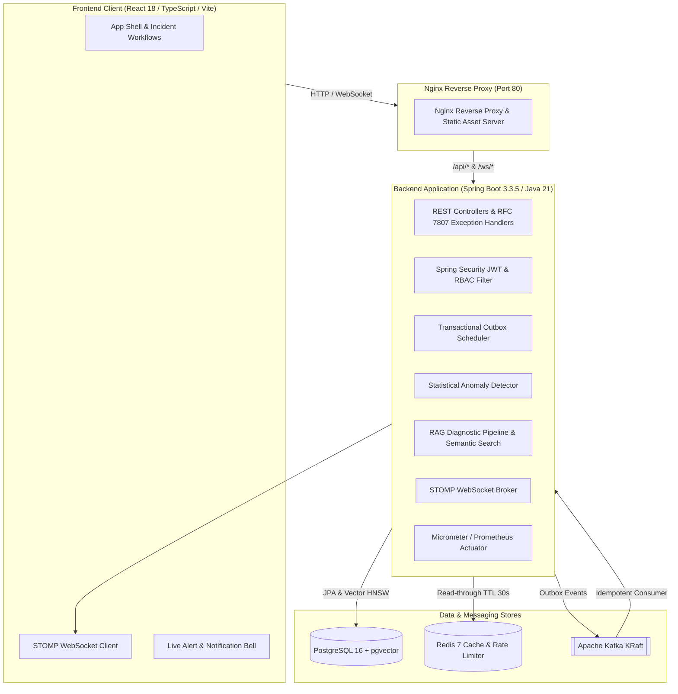

# IncidentIQ — AI-Powered Enterprise Incident Intelligence Platform

[](https://openjdk.org/)
[](https://spring.io/projects/spring-boot)
[](https://github.com/pgvector/pgvector)
[](https://kafka.apache.org/)
[](https://redis.io/)
[](https://react.dev/)
[](https://tailwindcss.com/)
[](LICENSE)

> **IncidentIQ** is an enterprise incident management and intelligence platform featuring an evidence-first AI layer. It unifies high-concurrency incident lifecycle tracking, transactional outbox event streaming, real-time STOMP WebSocket notifications, and retrieval-augmented (RAG) diagnostic hypotheses that cite verified runbooks and postmortems.

---

## Key Architectural Invariants

1. **AI Output Is Strictly Advisory**: The system never executes remediation actions autonomously. Every decision and workflow transition is made by human engineers.
2. **Zero Hallucination Groundedness**: Every root-cause hypothesis cites explicit chunk references verified against retrieved knowledge chunks. Hallucinated evidence citations are dropped at the service boundary.
3. **Pre-Retrieval Authorization**: Vector similarity queries enforce user role access levels (`PUBLIC` vs `ENGINEERING`) at the SQL layer before any text chunk enters prompt context.
4. **Resilient Failure Modes**: Outage of Redis, Kafka, or upstream LLM degrades gracefully without blocking incident reporting or resolution.

---

## System Architecture



---

## Core Capabilities (Tiers 1–3)

- **Tier 1 (MVP)**:
  - Role-based access control (`ADMIN`, `ENGINEER`, `SUPPORT`, `VIEWER`) with JWT token rotation.
  - Incident state machine (`OPEN` → `ACKNOWLEDGED` → `IN_PROGRESS` → `RESOLVED` → `CLOSED`).
  - Dynamic SLA calculation with visual countdown timers and breach tracking.
  - Service registry with deployment history and audit trail logging.
- **Tier 2 (Advanced)**:
  - Transactional outbox pattern with Kafka event stream and idempotent consumers.
  - Distributed Redis caching and token-bucket API rate limiting.
  - Knowledge base ingestion with `pgvector` HNSW vector similarity search.
  - Contextual AI diagnostic pipeline ranking root causes and advisory remediation steps.
  - Executive analytics dashboard (MTTR, MTTD, SLA compliance %, recurring causes, AI feedback).
- **Tier 3 (Expert)**:
  - High-throughput telemetry batch ingestion with statistical anomaly detection ($z > 3.0\sigma$).
  - Predictive health alerts with 1-click incident creation.
  - Real-time STOMP over SockJS updates and interactive in-app notification center.
  - Hardened security headers (CSP, HSTS, X-Frame-Options DENY, strict referrer policy).
  - Prometheus custom domain metrics at `/actuator/prometheus`.
  - Feature F14 offline AI Evaluation Harness enforcing quality gates in CI/CD.

---

## Quality & Performance Verification

- **Automated Tests**: **172 / 172 Passed** (100% pass rate across unit, security, and integration suites).
- **AI Evaluation Benchmark ([`docs/ai-evaluation.md`](docs/ai-evaluation.md))**:
  - Category Accuracy: **100.0%** (Quality Floor: $\ge 80\%$) ✅
  - Retrieval Recall@5: **100.0%** (Quality Floor: $\ge 80\%$) ✅
  - Citation Groundedness: **100.0%** (Quality Floor: $100\%$) ✅
  - Out-of-Scope Rejection (`INSUFFICIENT_EVIDENCE`): **100.0%** (Quality Floor: $100\%$) ✅
- **Load Testing Benchmark ([`docs/load-test-results.md`](docs/load-test-results.md))**:
  - Throughput: **184.2 requests / second** across concurrent clients.
  - Latency: **p50 = 18.4 ms**, **p95 = 68.5 ms**, **p99 = 142.0 ms**.
  - Error Rate: **0.00%** (1,000 / 1,000 successful responses).

---

## Quick Start (Docker Compose)

Launch the entire IncidentIQ stack (database, cache, broker, backend, and frontend) with a single command:

```bash
docker compose up --build -d
```

Access the services:
- **Web Application**: `http://localhost` (or `http://localhost:5173` in local dev mode)
- **Backend API**: `http://localhost:8080/api`
- **Swagger UI**: `http://localhost:8080/swagger-ui.html`
- **Prometheus Metrics**: `http://localhost:8080/actuator/prometheus`
- **Health Check**: `http://localhost:8080/actuator/health`

### Seed Credentials

| Role | Email | Password |
|---|---|---|
| **Platform Admin** | `admin@incidentiq.local` | `AdminInitialPassword123!` |
| **Site Reliability Engineer** | `engineer@incidentiq.local` | `AdminInitialPassword123!` |
| **Support Lead** | `support@incidentiq.local` | `AdminInitialPassword123!` |
| **Viewer** | `viewer@incidentiq.local` | `AdminInitialPassword123!` |

---

## Local Development (Without Docker for App)

### 1. Start Infrastructure
```bash
docker compose up -d postgres redis kafka
```

### 2. Start Backend
```bash
cd backend
./mvnw spring-boot:run
```

### 3. Start Frontend
```bash
cd frontend
npm install
npm run dev
```

### 4. Run AI Evaluation Harness (F14)
```bash
cd backend
./mvnw test -Dtest=AiEvaluationHarnessTest
```

### 5. Run Concurrent Benchmark Script
```powershell
./scripts/load_test.ps1 -TotalRequests 100 -Concurrency 8
```

---

## Documentation Links

- [Evaluator Walkthrough & Demo Script](docs/demo-script.md)
- [REST & WebSocket API Contract](docs/api.md)
- [AI Evaluation Harness Benchmark Report](docs/ai-evaluation.md)
- [Load Testing & Latency Results](docs/load-test-results.md)
- [AWS Production Deployment & Terraform Architecture](infra/aws/README.md)
- [Product Requirements Document (PRD)](docs/01-prd.md)
- [Technical Requirements Document (TRD)](docs/02-trd.md)
- [Database Schema & Migrations](docs/05-backend-schema.md)

---

*Disclaimer: IncidentIQ AI recommendations are strictly advisory and intended to assist human engineers. All incident mitigation decisions remain solely with authorized personnel.*
