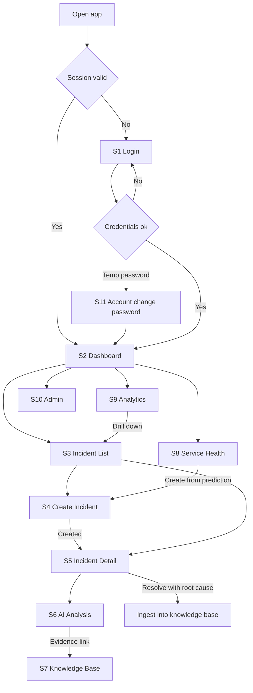

# 03 - App Flow

## 1. Entry points
- **First visit**: Any URL without a session redirects to `/login` and remembers the intended route.
- **Returning user**: A valid refresh cookie silently restores the session and opens the Dashboard (`/`) or the remembered route.
- **Shared or deep link**: `/incidents/{id}`, `/incidents/{id}/analysis` and `/services/{id}` work after login and redirect back. Unknown routes show a Not Found page.

## 2. Authentication flow
- **Sign up**: None. ADMIN creates users in Admin (`S10`).
- **Sign in**: `S1 Login`. Success stores the access token in memory and the refresh token in an httpOnly cookie. If `must_change_password` is set, go to `S11 Account` (change password) before anything else.
- **Verification**: None in v1.
- **Password recovery**: ADMIN resets the password in Admin; the user signs in with the temporary password and must change it.
- **Sign out**: Revokes the refresh token, clears in-memory state, returns to `S1`.

## 3. Screen inventory
| ID | Screen | Route | Roles | Purpose | Primary action | Next |
|---|---|---|---|---|---|---|
| S1 | Login | `/login` | Public | Authenticate | Sign in | S2 or remembered route |
| S2 | Dashboard | `/` | All | Operational overview | Open incident | S5, S3, S8 |
| S3 | Incident List | `/incidents` | All | Search and filter incidents | New incident | S4, S5 |
| S4 | Create Incident | `/incidents/new` | ADMIN, ENGINEER, SUPPORT | Report an incident | Create | S5 |
| S5 | Incident Detail | `/incidents/{id}` | All (actions by role) | Work an incident: timeline, comments, workflow, AI summary | Run or view AI analysis | S6 |
| S6 | AI Analysis | `/incidents/{id}/analysis` | All (feedback by role) | Evidence-backed root causes and recommendations | Give feedback | S5 |
| S7 | Knowledge Base | `/knowledge` | All (content by access level) | Browse, add and search knowledge | Search or Add document | S5 (evidence links) |
| S8 | Service Health | `/services`, `/services/{id}` | All | Service list and health detail with metrics and predictions | Create incident from prediction | S4 |
| S9 | Analytics | `/analytics` | All | MTTR, MTTD, SLA, volume, causes, AI feedback | Change range | S3 (drill-down) |
| S10 | Admin | `/admin` | ADMIN | Users, Services, AI and SLA settings, Audit log (tabs) | Save | - |
| S11 | Account | `/account` | All | Change own password and sign out | Change password | S2 |

## 4. Primary user journey
A support engineer signs in (S1), opens New incident (S4), enters title, description, severity, priority, service and an optional log snippet, and creates it. The app opens S5. The incident appears immediately; within seconds a banner shows the AI analysis is running and then completed. The engineer sees category and priority suggestions, similar past incidents and a summary on S5, opens S6 to read ranked root causes with cited evidence and confidence, marks recommendations accepted or rejected, rates the analysis, accepts the suggested priority, assigns an ENGINEER, and later the ENGINEER resolves the incident with root cause and resolution text. The resolved incident is ingested into the knowledge base and shows up in future similar-incident results.

## 5. Secondary journeys
- **Knowledge**: ENGINEER opens S7, adds a runbook, watches ingestion status change to INGESTED, then searches by meaning and opens a result.
- **Prediction**: SRE opens S2 or S8, sees a HIGH-risk prediction, clicks Create incident from prediction, S4 opens prefilled.
- **Manager**: opens S9, changes range to 90 days, reviews MTTR, SLA compliance, recurring causes and AI helpful rate, drills into S3 with filters.
- **Admin**: creates a user, resets a password, changes AI settings, reviews the audit log.
- **Failed AI**: S5 shows analysis FAILED with a Retry action; the incident remains fully usable.

## 6. Decision points
| User action | Condition | Result | Destination |
|---|---|---|---|
| Sign in | Invalid credentials | Generic error | Stay on S1 |
| Sign in | Account locked | Error with retry time | Stay on S1 |
| Sign in | must_change_password | Force password change | S11 |
| Create incident | Validation error | Inline errors | Stay on S4 |
| Create incident | Success | Toast and redirect | S5 |
| Change status | Invalid transition | Error listing allowed transitions | Stay on S5 |
| Resolve | Root cause or resolution empty | Dialog blocks submit | Stay on S5 |
| Edit incident | Stale version (409) | Prompt to reload latest | S5 refreshed |
| Run AI analysis | Rate limit reached | 429 message with retry time | Stay on S5 |
| Run AI analysis | VIEWER role | Action hidden | - |
| Open analysis | INSUFFICIENT_EVIDENCE | Show explanatory state, no causes | S6 |
| Add document | Duplicate hash | Rejected with message | Stay on S7 |
| Open restricted route | Role not allowed | 403 page | Previous or S2 |

## 7. Edge cases and recovery
- **Invalid input**: Field-level messages from Zod and server validation.
- **Failed request**: Toast with retry; TanStack Query retries idempotent GETs twice.
- **Lost connection**: Banner *Connection lost*; WebSocket reconnects with backoff; polling every 30 s; mutations are not queued.
- **Missing permissions**: Controls hidden or disabled with a reason; direct URL shows 403.
- **Expired session**: Access token expiry triggers one silent refresh; refresh failure returns to S1 with route remembered.
- **Cancelled action**: Dialogs close without change; unsaved form changes prompt before leaving.
- **AI failure or slow response**: Status chips (Pending, Running, Failed) with Retry; no blocking spinners on S5.
- **Kafka or Redis down**: Invisible to users; dashboard may show slightly stale data.

## 8. Navigation rules
- **Global navigation**: Left sidebar with Dashboard, Incidents, Knowledge, Services, Analytics, Admin (ADMIN only), and user menu (Account, Sign out). A global search box opens S3 with query.
- **Back behaviour**: Browser back works everywhere; filters and pagination live in the URL query string.
- **Protected routes**: All except `/login` need a session; `/admin` needs ADMIN; `/incidents/new` needs create permission.
- **Deep links**: Preserved through login via a return path.

## 9. Flowchart

## 10. Screen-by-screen behaviour
- **S1 Login (`/login`)**: Email and password form, error area, product name. No registration link. Enter submits. Loading spinner, generic/lockout error message, redirect on success.
- **S2 Dashboard (`/`)**: KPI cards (open by priority, unassigned, SLA at risk, resolved 7 days, MTTR when available), 30-day trend chart, top affected services, recent incidents, active predictions panel (Tier 3), AI activity (analyses today, helpful rate).
- **S3 Incident List (`/incidents`)**: Search box, filters (status, priority, service, assignee, tag, date range), sortable table (id, title, priority, status, service, assignee, SLA, age), pagination.
- **S4 Create Incident (`/incidents/new`)**: Form: title, description, severity, priority, service (searchable), tags, started at (optional), log snippet (optional, 4 KB counter). Prefill from prediction.
- **S5 Incident Detail (`/incidents/{id}`)**: Header (title, priority and status chips, SLA countdown), fields panel, workflow actions (assign, escalate, status, resolve, close, reopen), timeline, comments, log snippets, AI panel (status, category and priority suggestion with Accept buttons, summary, top cause, similar incidents), link to S6.
- **S6 AI Analysis (`/incidents/{id}/analysis`)**: AI-generated label, model and prompt version, ranked root causes with confidence bars and evidence references, evidence cards (source type, title, similarity, snippet, link), recommended actions (not executed) with Accept, Reject, Done, helpful rating and comment, analysis history selector.
- **S7 Knowledge Base (`/knowledge`)**: Tabs: Documents (title, type, service, access level, status, chunks) and Search (query, filters, ranked results with similarity and snippets). Add document dialog (paste or upload).
- **S8 Service Health (`/services`, `/services/{id}`)**: List: services with health chip, open incidents, risk level. Detail: metric charts (six metrics, 24 h and 7 d), deployments marker line, active predictions, open incidents.
- **S9 Analytics (`/analytics`)**: Range selector (7, 30, 90 days), KPI cards (MTTR, MTTD, SLA compliance), volume chart by priority, SLA chart, recurring causes table, AI feedback panel.
- **S10 Admin (`/admin`)**: Tabs: Users (table, create, role, enable, reset password), Services (CRUD), Settings (AI toggles, top-k, minimum similarity, rate limits, SLA table), Audit log (filters, paging). Last ADMIN cannot be disabled or demoted.
- **S11 Account (`/account`)**: Name and role (read only), change password form (current, new, confirm), Sign out. Forced mode hides navigation until password changed.
