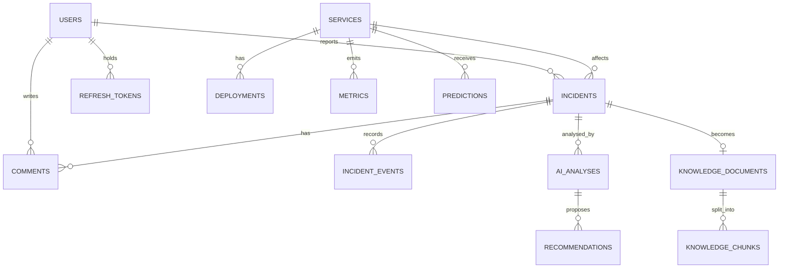

# 05 - Backend Schema

## 1. Data overview
- **Database**: PostgreSQL 16 with the pgvector extension.
- **Keys & IDs**: UUID primary keys (`gen_random_uuid()`) except high-volume tables that use identity bigints (`metrics`, `audit_logs`).
- **Timestamps**: All timestamps are `timestamptz` in UTC.
- **Domains**: Identity (`users`, `refresh_tokens`); catalog (`services`, `deployments`); incidents (`incidents`, `incident_events`, `comments`); knowledge (`knowledge_documents`, `knowledge_chunks`); AI (`ai_analyses`, `recommendations`); telemetry (`metrics`, `predictions`); platform (`audit_logs`, `outbox_events`, `processed_events`, `app_settings`).
- **Ownership**: Single tenant. Users act through roles; no per-row ownership beyond reporter and assignee.

## 2. Authentication and authorisation
- **Identity**: `users.email` (unique, case-insensitive). Sign-in: email and password. Roles: `ADMIN`, `ENGINEER`, `SUPPORT`, `VIEWER` (check constraint).
- **Sessions**: JWT access tokens (not stored) and rotating refresh tokens stored as hashes in `refresh_tokens` with family ids.
- **Permissions**: Enforced in the service layer using the matrix in TRD section 5; the database enforces integrity, not roles.

## 3. Tables

### `users`
| Column | Type | Rules |
|---|---|---|
| `id` | UUID | PK |
| `name` | VARCHAR(100) | Required |
| `email` | VARCHAR(254) | Required; UNIQUE on lower(email) |
| `password_hash` | VARCHAR(100) | Required; BCrypt |
| `role` | VARCHAR(20) | Required; CHECK in `ADMIN`, `ENGINEER`, `SUPPORT`, `VIEWER` |
| `enabled` | BOOLEAN | Default true |
| `must_change_password` | BOOLEAN | Default false |
| `failed_login_count` | INT | Default 0 |
| `locked_until` | TIMESTAMPTZ | Nullable |
| `last_login_at` | TIMESTAMPTZ | Nullable |
| `created_at` | TIMESTAMPTZ | Required |
| `updated_at` | TIMESTAMPTZ | Required |

### `refresh_tokens`
| Column | Type | Rules |
|---|---|---|
| `id` | UUID | PK |
| `user_id` | UUID | FK `users` ON DELETE CASCADE; INDEX |
| `family_id` | UUID | Required; INDEX (revoke whole family on reuse) |
| `token_hash` | CHAR(64) | Required; UNIQUE (SHA-256) |
| `expires_at` | TIMESTAMPTZ | Required |
| `revoked_at` | TIMESTAMPTZ | Nullable |
| `replaced_by` | UUID | Nullable |
| `created_at` | TIMESTAMPTZ | Required |

### `services`
| Column | Type | Rules |
|---|---|---|
| `id` | UUID | PK |
| `name` | VARCHAR(100) | Required; UNIQUE with environment |
| `environment` | VARCHAR(20) | CHECK in `PROD`, `STAGING`, `DEV` |
| `owner_team` | VARCHAR(100) | Required |
| `criticality` | VARCHAR(10) | CHECK in `LOW`, `MEDIUM`, `HIGH`, `CRITICAL` |
| `description` | TEXT | Nullable |
| `active` | BOOLEAN | Default true |
| `created_at` | TIMESTAMPTZ | Required |
| `updated_at` | TIMESTAMPTZ | Required |

### `deployments`
| Column | Type | Rules |
|---|---|---|
| `id` | UUID | PK |
| `service_id` | UUID | FK `services`; INDEX (`service_id`, `deployed_at` DESC) |
| `version` | VARCHAR(50) | Required |
| `deployed_at` | TIMESTAMPTZ | Required |
| `deployed_by` | VARCHAR(100) | Nullable |
| `notes` | TEXT | Nullable |
| `created_at` | TIMESTAMPTZ | Required |

### `incidents`
| Column | Type | Rules |
|---|---|---|
| `id` | UUID | PK; a human-friendly sequence number (`INC-0001`) is kept in `number` BIGINT GENERATED, UNIQUE |
| `title` | VARCHAR(200) | Required |
| `description` | TEXT | Required; max 10,000 chars (validated) |
| `severity` | VARCHAR(10) | CHECK in `CRITICAL`, `HIGH`, `MEDIUM`, `LOW` |
| `priority` | VARCHAR(2) | CHECK in `P1`, `P2`, `P3`, `P4`; default `P3` |
| `status` | VARCHAR(15) | CHECK in `OPEN`, `ACKNOWLEDGED`, `IN_PROGRESS`, `RESOLVED`, `CLOSED`; default `OPEN` |
| `category` | VARCHAR(20) | Nullable; CHECK in 9 categories: `DATABASE`, `NETWORK`, `APPLICATION`, `INFRASTRUCTURE`, `DEPLOYMENT`, `SECURITY`, `THIRD_PARTY`, `PERFORMANCE`, `OTHER` |
| `service_id` | UUID | FK `services`; INDEX (`service_id`, `created_at` DESC) |
| `reporter_id` | UUID | FK `users`; Required |
| `assignee_id` | UUID | FK `users`; Nullable; INDEX on `assignee_id` |
| `tags` | TEXT[] | Default empty; GIN index |
| `started_at` | TIMESTAMPTZ | Nullable |
| `acknowledged_at` | TIMESTAMPTZ | Nullable |
| `resolved_at` | TIMESTAMPTZ | Nullable |
| `closed_at` | TIMESTAMPTZ | Nullable |
| `escalated_at` | TIMESTAMPTZ | Nullable |
| `escalation_count` | INT | Default 0 |
| `root_cause` | TEXT | Required when status is `RESOLVED` or `CLOSED` (CHECK) |
| `resolution` | TEXT | Required when status is `RESOLVED` or `CLOSED` (CHECK) |
| `sla_response_due_at` | TIMESTAMPTZ | Computed from priority |
| `sla_resolve_due_at` | TIMESTAMPTZ | Computed from priority |
| `sla_breached` | BOOLEAN | Default false |
| `search_vector` | TSVECTOR | Generated from title and description; GIN index |
| `version` | BIGINT | Optimistic lock |
| `created_at` | TIMESTAMPTZ | Required; INDEX (`status`, `priority`) |
| `updated_at` | TIMESTAMPTZ | Required |

### `incident_events`
| Column | Type | Rules |
|---|---|---|
| `id` | UUID | PK |
| `incident_id` | UUID | FK `incidents` ON DELETE CASCADE; INDEX (`incident_id`, `created_at`) |
| `event_type` | VARCHAR(30) | CHECK in `CREATED`, `STATUS_CHANGED`, `ASSIGNED`, `ESCALATED`, `PRIORITY_CHANGED`, `COMMENT_ADDED`, `LOG_ADDED`, `DEPLOYMENT_LINKED`, `AI_ANALYSIS_COMPLETED`, `AI_ANALYSIS_FAILED`, `PREDICTION_LINKED` |
| `actor_id` | UUID | FK `users` nullable (system events) |
| `payload` | JSONB | Default empty object `{}` |
| `created_at` | TIMESTAMPTZ | Required |

### `comments`
| Column | Type | Rules |
|---|---|---|
| `id` | UUID | PK |
| `incident_id` | UUID | FK `incidents` ON DELETE CASCADE; INDEX (`incident_id`, `created_at`) |
| `user_id` | UUID | FK `users`; Required |
| `body` | TEXT | Required; 1 to 4,000 chars |
| `created_at` | TIMESTAMPTZ | Required |
| `edited_at` | TIMESTAMPTZ | Nullable |

### `knowledge_documents`
| Column | Type | Rules |
|---|---|---|
| `id` | UUID | PK |
| `title` | VARCHAR(200) | Required |
| `source_type` | VARCHAR(12) | CHECK in `RUNBOOK`, `FAQ`, `POSTMORTEM`, `INCIDENT` |
| `source_uri` | TEXT | Nullable |
| `incident_id` | UUID | FK `incidents`; UNIQUE; set only for INCIDENT documents |
| `service_id` | UUID | FK `services` nullable |
| `access_level` | VARCHAR(12) | CHECK in `PUBLIC`, `ENGINEERING`; default `PUBLIC` |
| `content_hash` | CHAR(64) | Required; UNIQUE (duplicate detection) |
| `version` | INT | Default 1 |
| `status` | VARCHAR(12) | CHECK in `PENDING`, `PROCESSING`, `INGESTED`, `FAILED` |
| `chunk_count` | INT | Default 0 |
| `error_message` | TEXT | Nullable |
| `uploaded_by` | UUID | FK `users` nullable |
| `created_at` | TIMESTAMPTZ | Required |
| `updated_at` | TIMESTAMPTZ | Required |

### `knowledge_chunks`
| Column | Type | Rules |
|---|---|---|
| `id` | UUID | PK |
| `document_id` | UUID | FK `knowledge_documents` ON DELETE CASCADE; UNIQUE with `chunk_index` |
| `chunk_index` | INT | Required |
| `token_count` | INT | Required |
| `content` | TEXT | Required |
| `embedding` | VECTOR(384) | Required; HNSW index using `vector_cosine_ops` (`m` 16, `ef_construction` 64) |
| `source_type` | VARCHAR(12) | Denormalised from document for fast filtering |
| `access_level` | VARCHAR(12) | Denormalised from document for fast filtering |
| `service_id` | UUID | Denormalised from document for fast filtering |
| `metadata` | JSONB | Holds heading path and title |
| `created_at` | TIMESTAMPTZ | Required |

### `ai_analyses`
| Column | Type | Rules |
|---|---|---|
| `id` | UUID | PK |
| `incident_id` | UUID | FK `incidents` ON DELETE CASCADE; INDEX (`incident_id`, `created_at` DESC) |
| `trigger` | VARCHAR(6) | CHECK in `AUTO`, `MANUAL` |
| `requested_by` | UUID | FK `users` nullable (AUTO) |
| `status` | VARCHAR(22) | CHECK in `PENDING`, `RUNNING`, `COMPLETED`, `INSUFFICIENT_EVIDENCE`, `FAILED` |
| `model` | VARCHAR | Required |
| `embedding_model` | VARCHAR | Required |
| `prompt_version` | VARCHAR | Required |
| `category` | VARCHAR(20) | Nullable; same enums as incidents |
| `suggested_priority` | VARCHAR(2) | Nullable; same enums as incidents |
| `summary` | TEXT | Nullable |
| `confidence` | NUMERIC(3,2) | Top root-cause confidence; CHECK between 0 and 1 |
| `root_causes` | JSONB | `cause`, `confidence`, `evidenceRefs` |
| `evidence` | JSONB | `chunkId`, `documentId`, `title`, `sourceType`, `similarity`, `snippet` |
| `evidence_sufficient` | BOOLEAN | Required |
| `input_tokens` | INT | Nullable until completion |
| `output_tokens` | INT | Nullable until completion |
| `latency_ms` | INT | Nullable until completion |
| `error_code` | VARCHAR | Nullable |
| `correlation_id` | VARCHAR | Required |
| `created_at` | TIMESTAMPTZ | Required |
| `completed_at` | TIMESTAMPTZ | Nullable |

### `recommendations`
| Column | Type | Rules |
|---|---|---|
| `id` | UUID | PK |
| `analysis_id` | UUID | FK `ai_analyses` ON DELETE CASCADE; INDEX |
| `position` | INT | Display order; UNIQUE with `analysis_id` |
| `action` | TEXT | Required |
| `rationale` | TEXT | Required |
| `status` | VARCHAR(10) | CHECK in `SUGGESTED`, `ACCEPTED`, `REJECTED`, `COMPLETED`; default `SUGGESTED` |
| `feedback_rating` | VARCHAR(11) | Nullable; CHECK in `HELPFUL`, `NOT_HELPFUL` |
| `feedback_comment` | TEXT | Nullable |
| `feedback_by` | UUID | FK `users` nullable |
| `feedback_at` | TIMESTAMPTZ | Nullable |
| `created_at` | TIMESTAMPTZ | Required |

### `metrics`
| Column | Type | Rules |
|---|---|---|
| `id` | BIGINT identity | PK |
| `service_id` | UUID | FK `services`; Required |
| `metric_name` | VARCHAR(25) | CHECK in `CPU_PERCENT`, `MEMORY_PERCENT`, `DISK_PERCENT`, `LATENCY_P95_MS`, `THROUGHPUT_RPS`, `ERROR_RATE_PERCENT` |
| `value` | DOUBLE PRECISION | Required |
| `recorded_at` | TIMESTAMPTZ | Required; UNIQUE (`service_id`, `metric_name`, `recorded_at`); INDEX (`service_id`, `metric_name`, `recorded_at` DESC) |

### `predictions`
| Column | Type | Rules |
|---|---|---|
| `id` | UUID | PK |
| `service_id` | UUID | FK `services`; INDEX (`service_id`, `created_at` DESC) |
| `anomaly_score` | NUMERIC(4,3) | 0 to 1 |
| `risk_level` | VARCHAR(6) | CHECK in `LOW`, `MEDIUM`, `HIGH` |
| `failure_probability` | NUMERIC(4,3) | Nullable; set only when source is `ML` |
| `horizon_minutes` | INT | Default 30 |
| `source` | VARCHAR(12) | CHECK in `STATISTICAL`, `ML` |
| `model_version` | VARCHAR(50) | Required |
| `contributing_metrics` | JSONB | Metric names with scores |
| `status` | VARCHAR(10) | CHECK in `ACTIVE`, `RESOLVED`, `DISMISSED`; default `ACTIVE`; INDEX |
| `incident_id` | UUID | FK `incidents` nullable |
| `created_at` | TIMESTAMPTZ | Required |

### `audit_logs`
| Column | Type | Rules |
|---|---|---|
| `id` | BIGINT identity | PK |
| `user_id` | UUID | FK `users` ON DELETE SET NULL; INDEX (`user_id`, `created_at` DESC) |
| `action` | VARCHAR(60) | Required (e.g. `LOGIN_SUCCESS`, `ROLE_CHANGED`, `AI_ANALYSIS_REQUESTED`) |
| `entity_type` | VARCHAR(50) | INDEX (`entity_type`, `entity_id`) |
| `entity_id` | VARCHAR(50) | INDEX (`entity_type`, `entity_id`) |
| `metadata` | JSONB | Context details |
| `ip_address` | INET | Nullable |
| `correlation_id` | VARCHAR(64) | Nullable |
| `created_at` | TIMESTAMPTZ | Append-only: trigger rejects UPDATE and DELETE |

### `outbox_events`
| Column | Type | Rules |
|---|---|---|
| `id` | UUID | PK; used as event id |
| `topic` | VARCHAR(100) | Required |
| `event_key` | VARCHAR(100) | Required |
| `payload` | JSONB | Full envelope |
| `created_at` | TIMESTAMPTZ | Required |
| `published_at` | TIMESTAMPTZ | Published null until sent; partial INDEX where `published_at IS NULL` |
| `attempts` | INT | Default 0 |

### `processed_events`
| Column | Type | Rules |
|---|---|---|
| `consumer` | VARCHAR(100) | Part of PK |
| `event_id` | UUID | Part of PK (`consumer`, `event_id`) |
| `processed_at` | TIMESTAMPTZ | Retention 14 days (scheduled purge) |

### `app_settings`
| Column | Type | Rules |
|---|---|---|
| `key` | VARCHAR(100) | PK |
| `value` | JSONB | Required; validated per key |
| `description` | TEXT | Nullable |
| `updated_by` | UUID | FK `users` nullable |
| `updated_at` | TIMESTAMPTZ | Required |

**Seed keys**:
- `ai.enabled`: `true`
- `ai.auto_analyze`: `true`
- `ai.rag.top_k`: `5`
- `ai.rag.min_similarity`: `0.40`
- `ai.rate_limit_per_user_per_hour`: `10`
- `sla.targets`: `{"P1": {"responseMinutes": 15, "resolveMinutes": 240}, "P2": {"responseMinutes": 30, "resolveMinutes": 480}, "P3": {"responseMinutes": 240, "resolveMinutes": 4320}, "P4": {"responseMinutes": 1440, "resolveMinutes": 10080}}`
- `prediction.risk_thresholds`: `{"high": 0.80, "medium": 0.50}`
- `retention.metrics_days`: `90`

## 4. Relationships (ERD)

## 5. Access rules
| Table | Create | Read | Update | Delete |
|---|---|---|---|---|
| `users` | ADMIN | ADMIN (self for own profile) | ADMIN; self password | Not supported (disable) |
| `refresh_tokens` | System | System | System | System (expiry job) |
| `services`, `deployments` | ADMIN (services); ENGINEER, ADMIN (deployments) | All | ADMIN | Services: deactivate only |
| `incidents`, `incident_events`, `comments` | ADMIN, ENGINEER, SUPPORT | All | Per role matrix; events never | Not supported |
| `knowledge_documents`, `knowledge_chunks` | ENGINEER, ADMIN; system (incidents) | By access_level | System (re-ingest) | ADMIN (cascades chunks) |
| `ai_analyses`, `recommendations` | System | All | System; feedback by ADMIN, ENGINEER, SUPPORT | Cascade only |
| `metrics`, `predictions` | System, ENGINEER, ADMIN | All | System; dismiss by ENGINEER, ADMIN | Retention job |
| `audit_logs` | System | ADMIN | Never | Never |
| `outbox_events`, `processed_events` | System | System | System | Retention job |
| `app_settings` | Seed | ADMIN (and server) | ADMIN | Never |

## 6. Core data operations
- `createIncident`: Inserts incident (SLA due times from settings), `CREATED` incident_event, outbox event `incident.created`, and audit row.
- `transition`: Load by ID with version check, validate state machine (`OPEN -> ACKNOWLEDGED -> IN_PROGRESS -> RESOLVED -> CLOSED`; `RESOLVED -> IN_PROGRESS`), update timestamps, insert event and outbox row.
- `escalate`: Priority moves up one level (minimum P1), `escalation_count` increments, SLA due times recomputed from `created_at`, `ESCALATED` event and `incident.escalated` outbox row.
- `search`: Filter predicates plus `search_vector` match, ordered and paginated.
- `vectorSearch`: `SELECT chunks WHERE access_level IN allowed_levels AND optional filters ORDER BY embedding <=> query LIMIT k`, then filter by min similarity.
- `ingestDocument`: Insert doc (`PENDING`), chunk, embed, insert chunks, set `INGESTED` atomically.
- `saveAnalysis`: Updates `ai_analyses`, inserts `recommendations`, writes event, outbox and audit rows.
- `ingestMetricsBatch`: `INSERT ... ON CONFLICT DO NOTHING` on unique key; then outbox `service.metric.received`.
- `retention jobs`: Delete metrics older than 90 days, processed_events older than 14 days, expired refresh tokens; SLA breach scan every minute.

## 7. Migration and seed data
- Flyway migrations `V1` onward: extensions (`vector`, `pgcrypto`) first, then tables, indexes, triggers. Hibernate runs in validate mode.
- Bootstrap admin from `ADMIN_BOOTSTRAP_EMAIL` and `ADMIN_BOOTSTRAP_PASSWORD` on first start.
